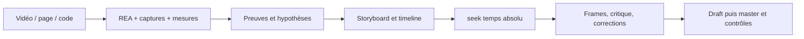

# Codex Motion Design

Un atelier de motion design **code-first pour Codex et ChatGPT** : diriger un
film, calculer chaque image au temps demandé, critiquer des frames et exporter
un MP4 avec son synchronisé. Tout se rend localement avec Node, Playwright et
FFmpeg. Aucun SDK de modèle, clé API, plugin ou dépendance Claude n'est requis.

**La création est réservée à GPT-6 Astra** : direction, storyboard, code, assets,
prompts et corrections. Le [workflow Astra](docs/ASTRA_WORKFLOW.md) décrit cette
règle d'auteur ; le rendu des fichiers existants reste entièrement local.


[Film exemple avec son](docs/assets/signal.mp4) ·
[Storyboard](STORYBOARD.md) · [Validation exécutée](docs/VALIDATION.md)

Le projet est indépendant et n'est pas un produit officiel OpenAI. Il adapte
des méthodes observées dans [six dépôts audités](docs/SOURCE_AUDIT.md), avec une
implémentation originale. Plusieurs sources supportaient déjà Codex : il s'agit
d'une synthèse critique, pas d'un renommage de fichiers Claude.
La [carte des capacités](docs/CAPABILITY_MAP.md) relie ce cœur aux six audits et
à REA, en distinguant les fonctions exécutables des extensions à construire.

## Démarrer en local

Prérequis : **Node 22.12+**, npm, Chromium et FFmpeg avec l'encodeur `libx264`.
Chromium s'installe via Playwright ; FFmpeg s'installe séparément et doit être
dans le PATH, ou indiqué par `FFMPEG_PATH`.

```sh
git clone https://github.com/coconut971/codex-motion-design.git
cd codex-motion-design
npm ci
npx playwright install chromium
npm run doctor
npm test
npm run verify
npm run studio
```

Ouvrir [le lecteur local](http://127.0.0.1:4173). Il possède lecture et scrub ;
aucun service distant n'est nécessaire. Pour rendre :

```sh
npm run sheet
npm run draft
npm run render -- --samples=4
```

Résultats : `out/sheet.png`, `out/draft.mp4` et `out/signal.mp4`, avec WAV et
manifests adjacents. L'exemple dure **8 s, 1920×1080, 30 i/s**, sur une grille à
120 BPM. Le draft utilise 960×540 à la même cadence. Ajouter `--overwrite`
pour remplacer une sortie existante : `npm run draft -- --overwrite`.

Sous Linux, `npx playwright install --with-deps chromium` installe aussi les
bibliothèques système nécessaires. Sous PowerShell, un navigateur ou FFmpeg
déjà installé peut être sélectionné pour la session :

```powershell
$env:CHROME_PATH = 'C:\Program Files\Google\Chrome\Application\chrome.exe'
$env:FFMPEG_PATH = 'C:\outils\ffmpeg\bin\ffmpeg.exe'
npm run doctor
$env:RENDER_INTEGRATION = '1'
npm test
```

Les trois tests d'échec d'export, de readiness et d'audio complet sont activés par `RENDER_INTEGRATION=1`
et requièrent navigateur + FFmpeg. La CI les active, vérifie les seeks et rend un
petit MP4. Les tests ordinaires du calcul ne demandent pas ces prérequis.

## Avec Codex

Ouvrir ce dossier dans Codex et donner un brief : sujet, public, idée principale,
format, durée, contraintes de marque, son et payoff. Codex utilise les règles du
[AGENTS.md](AGENTS.md) du dépôt ; cette convention est décrite dans la
[documentation officielle](https://learn.chatgpt.com/docs/agent-configuration/agents-md).
[.codex/config.toml](.codex/config.toml) définit **GPT-6 Astra** par défaut dans
Codex lorsque le projet est approuvé. Un choix explicite dans l'interface ou la
CLI peut remplacer ce défaut : vérifier le modèle actif dans le sélecteur ou
avec `/status` en CLI. Le fichier ne change pas la conversation en cours.
Voir les [règles officielles de configuration](https://learn.chatgpt.com/docs/config-file/config-basic).

Si la CLI Codex est installée, démarrer depuis ce dossier avec
`codex --model gpt-6-astra` ; cette [option officielle](https://learn.chatgpt.com/docs/cli/reference)
sélectionne explicitement le modèle. Si Astra est indisponible ou non vérifiable,
le signaler avant de générer, sans remplacement silencieux. Aucun paramètre
global ni clé API de rendu n'est ajouté.

Exemple de demande :

> Avec GPT-6 Astra exclusivement, crée un film de 10 secondes pour expliquer comment un signal devient une
> décision collective. Papier et indigo, sans texte, trois accents sonores.
> Suis AGENTS.md : storyboard, timeline unique, seek(t), critique par frames,
> brouillon puis master. Livre les preuves et les limites d'inspection.

Les [prompts de production](prompts/01-produce.md) couvrent aussi
[direction](prompts/02-art-direction.md), [critique](prompts/03-critique.md),
[retiming/son](prompts/04-retime-and-sound.md),
[debug](prompts/05-debug-render.md) et
[reverse engineering avec REA](prompts/07-reverse-engineer.md).

Avec ChatGPT, sélectionner GPT-6 Astra dans l'interface, fournir le brief et les fichiers
utiles, puis les images de revue.
La lecture automatique de fichiers locaux, l'exécution Node et l'accès à REA
dépendent des outils de la session. Le [prompt de passage à Codex](prompts/06-chatgpt-handoff.md)
permet de préparer un projet sans prétendre l'avoir exécuté.

## REA : analyser une référence existante

[REA — Reverse Engineer Anything](https://github.com/morluto/rea) est un outil
MIT compatible Codex. Il complète l'enquête sur une page, une application ou du
code ; il reste **optionnel**, hors dépendances du film et hors CI de rendu.
La version auditée est 6.5.0 et demande Node `^22.19.0`, `^24.11.0` ou `>=26`.

Installation officielle :

```sh
npx rea-agents setup
```

Pour cibler Codex et inspecter les modifications avant installation :

```sh
npx rea-agents@6.5.0 setup --client codex --dry-run
npx rea-agents@6.5.0 setup --client codex
```

Examiner les changements proposés, puis redémarrer Codex. Le setup configure
le serveur MCP et les instructions REA ; il n'ajoute aucune dépendance Claude
au projet. Les détails, chemins de configuration et vérifications sont dans
[REA_WORKFLOW.md](docs/REA_WORKFLOW.md). Le statut réel de l'installation et les
vérifications locales sont consignés dans ce guide. Une installation sur une
machine ne configure pas celle d'un lecteur qui clone le dépôt.

Le [cas Signal avec REA](docs/cases/REA_SIGNAL.md) documente le parcours concret
HTML → observations → reconstruction `seek(t)` → comparaison de frames → rendu,
avec ses commandes, preuves et limites.

Dans Codex, utiliser le [prompt d'enquête](prompts/07-reverse-engineer.md) :

> Avec GPT-6 Astra exclusivement, utilise REA pour enquêter sur [URL / dossier local]. Isole la transformation
> [comportement]. Relie chaque constat à une preuve et distingue observations,
> mesures et hypothèses. Produis une spécification de mouvement, puis une
> réimplémentation originale conforme au contrat seek(t) de ce dépôt.

Pour une **vidéo**, extraire des frames horodatées et mesurer coupes, trajectoires
et contacts avec FFmpeg/Playwright selon la source. REA aide sur la page ou le
code associé quand ils sont disponibles ; il ne retrouve pas le code source
original à partir des seuls pixels. Pour une **page**, relever les états avant/
après et ce qui déclenche le mouvement. Pour du **code**, suivre les paramètres,
timelines et ressources. Conserver l'enquête dans `work/`, puis transcrire les
mesures utiles dans le storyboard et les cues du projet.



## Contrats techniques

| Sujet | Règle exécutée ou vérifiée |
| --- | --- |
| Temps pur | `seek(t)` réécrit l'image entière, temps continu, hash et seed stables |
| Springs | Réponses analytiques sous-amortie, critique et suramortie ; ζ explicite |
| Goût | Banned list contextualisée, une lecture principale, anticipation et tenue |
| Beat grid | Un seul JSON, beats depuis zéro, offset explicite et cues nommées |
| Son | Les mêmes cues alimentent WAV stéréo 48 kHz et contact visuel |
| Critique | Images clés, planche par beat, strips, crop, miniature et journal |
| Capture | Canvas 2D local, readiness, erreurs fatales, sous-images limitées aux cuts |
| Export | MP4 temporaire, décodage des deux flux et comptage des frames avant livraison |

Lire [MOTION_RULES.md](docs/MOTION_RULES.md) pour les choix artistiques et les
formules, [RENDER_CONTRACT.md](docs/RENDER_CONTRACT.md) pour l'interface exacte.
Le blur moyenne les pixels sRGB : c'est une approximation, documentée dans le
manifest. Ce renderer vise Canvas 2D ; DOM, SVG ou WebGL nécessitent un adaptateur.

Captures ciblées :

```sh
node scripts/render.mjs --stills=.4,1.4,3.8,6.8 --scale=.5 --out=out/keys.png
node scripts/render.mjs --strip=1.8:2.2 --crop=580,200,760,680 --scale=.5 --out=out/contact.png
node scripts/render.mjs --stills=6.8 --scale=.1875 --out=out/mobile.png
```

Une planche ne prouve pas l'absence de flash entre ses samples. Un test de
déterminisme ne juge pas la qualité visuelle. Une crête mesurée ne remplace ni
une mesure LUFS ni une écoute : [les limites réellement rencontrées](docs/VALIDATION.md)
sont livrées avec les résultats.

## Structure

```text
AGENTS.md                  règles persistantes Codex / ChatGPT
.codex/config.toml         modèle Astra par défaut pour ce projet Codex
STORYBOARD.md              intention et chronologie de l'exemple
REVIEW.md                  observations et corrections vérifiées
project.json               format, seed, beat grid, cues, son
examples/signal.html       page de l'exemple et lecteur
examples/signal.mjs        seek(t) original, dessin et pilote de preview
lib/motion.mjs             springs, superposition, hash, interpolation
lib/project.mjs            validation du projet et conversion beats/secondes
scripts/                   serveur, doctor, capture, audio, vérification
tests/                     contrats mathématiques, timing, erreurs et confinement
prompts/                   sept briefs réutilisables
docs/                      workflow Astra, capacités, contrats, audits, REA et preuves
.github/workflows/         validation reproductible sur Linux
package-lock.json          versions verrouillées
```

`out/`, `work/` et les dépendances sont ignorés. Les sept clones de recherche ne
sont pas embarqués. Les seuls médias livrés sont générés par notre propre exemple.

## Provenance et licence

Code et prompts originaux sous [MIT](LICENSE). Playwright est sous Apache-2.0 ;
Chromium et FFmpeg conservent leurs propres licences. REA reste un outil externe
sous MIT. Aucune police ou musique tierce n'est embarquée.

L'[audit](docs/SOURCE_AUDIT.md) fige commits, méthodes observées et limites des
six sources. La source sous licence commerciale est exclue de toute réutilisation.
Les posts demandés de `@seeconvm`, `@humzaakhalid` et `@flxrnc` n'ont pas pu être
lus directement ; le [registre des recherches](docs/SOCIAL_SOURCES.md) sépare ces
pistes des faits établis. Aucune méthode ne leur est attribuée sans preuve.
