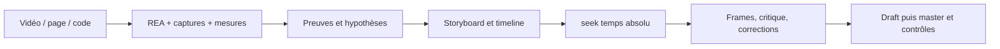

# Codex Motion Design

> **Expérimentation suspendue — objectif visuel non atteint.** Ce projet est
> mis de côté après deux essais locaux avec GPT-6 Astra, en efforts `high` puis
> `ultra`. Le résultat artistique a été jugé insuffisant par l’utilisateur,
> y compris sur une action courte dont la mécanique avait été vérifiée.
> Le dépôt conserve les outils et les preuves de cette expérimentation ; il
> ne démontre pas une capacité de production ou une qualité studio.
>
> **[Lire le rapport de clôture](docs/EXPERIMENT_REPORT.md)** ·
> [Limites constatées](docs/LIMITATIONS.md) ·
> [Périmètre des capacités](docs/CAPABILITY_MAP.md)

L’objectif était d’adapter à Codex/GPT des principes de workflows de motion
design associés à Claude, par un **reverse engineering simple et borné** des
outils et comportements observables. L’expérimentation a produit une chaîne
locale : storyboard, temps absolu, critique de frames et export MP4 avec son.
Elle n’a pas atteint l’exigence artistique fixée pour les films.

Le film public [L’atelier de l’aube](docs/assets/morning-press/film.mp4),
14 secondes réalisées avec Astra en effort `high`, conserve ses défauts
graphiques et de logique mécanique sous le levier. Un second essai local de
6 secondes, en effort `ultra`, a permis de vérifier la mécanique, mais son
graphisme a été jugé extrêmement pauvre. Ce second essai reste privé. Les
autres niveaux d’effort, dont `max`, n’ont pas été exécutés localement.

L’utilisateur rapporte des rendus nettement meilleurs avec Claude Opus 5.5
dans ses essais personnels ailleurs. Ce retour externe complète sa décision
de mettre ce projet de côté ; aucune comparaison contrôlée entre modèles
n’a été réalisée ici. Le blocage constaté avec Astra est une conclusion
opérationnelle pour cette expérimentation, sans portée universelle.

**Aucune nouvelle création ni reprise automatique n’est prévue.** Une reprise
nécessite une demande explicite de l’utilisateur. La règle d’auteur
**GPT-6 Astra exclusivement** demeure dans [AGENTS.md](AGENTS.md) et le
[workflow Astra](docs/ASTRA_WORKFLOW.md). Les instructions ci-dessous servent
à comprendre et reproduire les fichiers conservés. Leur rendu fonctionne
localement avec Node, Playwright et FFmpeg, sans SDK de modèle, clé API,
plugin ou dépendance Claude.

## Démonstrations techniques conservées


[Film du cœur avec son](docs/assets/core/film.mp4) ·
[Storyboard](examples/core-demo/STORYBOARD.md) · [Validation exécutée](docs/CORE_VALIDATION.md)

Le projet est indépendant et n'est pas un produit officiel OpenAI.
L'implémentation est originale. La [carte des capacités](docs/CAPABILITY_MAP.md)
distingue les fonctions exécutables des limites du périmètre livré.

Le [cœur `motion/1`](docs/CORE.md) compile un **descriptor JSON** en
scènes, objets persistants, pistes et images indépendantes : keyframes, cubic
bornée, springs avec retarget position/vitesse, trajectoires, caméra logarithmique,
masques et transitions. Canvas 2D et SVG DOM rendent le même état calculé.
[La graine et le pli](examples/core-demo/STORYBOARD.md), un film original de
10 secondes et trois plans, sert de démonstration technique de cette API. Les
[contrôles du cœur](docs/CORE_VALIDATION.md) complètent ceux de Signal.

```sh
npm run core:sheet
npm run core:verify
npm run core:draft
npm run core:render -- --samples=4
```

Après `npm run studio`, ouvrir
[le film du cœur](http://127.0.0.1:4173/examples/core-demo/index.html) ou sa
[version SVG](http://127.0.0.1:4173/examples/core-demo/index.html?adapter=svg).
Le lecteur accepte un descriptor avec `?project=/chemin/film.json`.
Les commandes historiques ci-dessous conservent l'exemple Signal par défaut.
Signal reste un [film de compatibilité avec son](docs/assets/signal.mp4), avec
son [storyboard](STORYBOARD.md) et ses [contrôles historiques](docs/VALIDATION.md).

## Reproduire les exemples en local

Prérequis : **Node 22.12+**, npm, Chromium et FFmpeg avec l'encodeur `libx264`.
Chromium s'installe via Playwright ; FFmpeg s'installe séparément et doit être
dans le PATH, ou indiqué par `FFMPEG_PATH`.

```sh
git clone https://github.com/coconut971/codex-motion-design.git
cd codex-motion-design
npm ci
npx playwright install chromium
npm run doctor
npm test
npm run verify
npm run studio
```

Ouvrir [le lecteur local](http://127.0.0.1:4173). Il possède lecture et scrub ;
aucun service distant n'est nécessaire. Pour rendre :

```sh
npm run sheet
npm run draft
npm run render -- --samples=4
```

Résultats : `out/sheet.png`, `out/draft.mp4` et `out/signal.mp4`, avec WAV et
manifests adjacents. L'exemple dure **8 s, 1920×1080, 30 i/s**, sur une grille à
120 BPM. Le draft utilise 960×540 à la même cadence. Ajouter `--overwrite`
pour remplacer une sortie existante : `npm run draft -- --overwrite`.

Sous Linux, `npx playwright install --with-deps chromium` installe aussi les
bibliothèques système nécessaires. Sous PowerShell, un navigateur ou FFmpeg
déjà installé peut être sélectionné pour la session :

```powershell
$env:CHROME_PATH = 'C:\Program Files\Google\Chrome\Application\chrome.exe'
$env:FFMPEG_PATH = 'C:\outils\ffmpeg\bin\ffmpeg.exe'
npm run doctor
$env:RENDER_INTEGRATION = '1'
npm test
```

Les trois tests d'échec d'export, de readiness et d'audio complet sont activés par `RENDER_INTEGRATION=1`
et requièrent navigateur + FFmpeg. La CI les active, vérifie les seeks et rend un
petit MP4. Les tests ordinaires du calcul ne demandent pas ces prérequis.

## Consignes et prompts conservés

[AGENTS.md](AGENTS.md) fixe le statut de mise en sommeil et les règles de
reproduction. [.codex/config.toml](.codex/config.toml) conserve **GPT-6 Astra**
comme modèle par défaut du projet. Ce fichier ne change pas le modèle d’une
conversation en cours ; toute éventuelle reprise créative devra vérifier le
modèle actif et respecter le [workflow Astra](docs/ASTRA_WORKFLOW.md).

Les [prompts de création](prompts/01-produce.md) sont conservés pour documenter
la méthode essayée. Ils couvrent aussi
[direction](prompts/02-art-direction.md), [critique](prompts/03-critique.md),
[retiming/son](prompts/04-retime-and-sound.md),
[debug](prompts/05-debug-render.md) et
[reverse engineering avec REA](prompts/07-reverse-engineer.md).

La lecture automatique de fichiers locaux, l'exécution Node et l'accès à REA
dépendent des outils de la session. Le [prompt de passage à Codex](prompts/06-chatgpt-handoff.md)
décrit la transmission des fichiers et des preuves d’exécution. Ces documents
restent des références de l’expérimentation, sans autoriser de nouveaux essais.

## REA : analyser une référence existante

[REA — Reverse Engineer Anything](https://github.com/morluto/rea) est un outil
MIT compatible Codex. Il complète l'enquête sur une page, une application ou du
code ; il reste **optionnel**, hors dépendances du film et hors CI de rendu.
La version auditée est 6.5.0 et demande Node `^22.19.0`, `^24.11.0` ou `>=26`.

Installation officielle :

```sh
npx rea-agents setup
```

Pour cibler Codex et inspecter les modifications avant installation :

```sh
npx rea-agents@6.5.0 setup --client codex --dry-run
npx rea-agents@6.5.0 setup --client codex
```

Examiner les changements proposés, puis redémarrer Codex. Le setup configure
le serveur MCP et les instructions REA ; il n'ajoute aucune dépendance Claude
au projet. Les détails, chemins de configuration et vérifications sont dans
[REA_WORKFLOW.md](docs/REA_WORKFLOW.md). Le statut réel de l'installation et les
vérifications locales sont consignés dans ce guide. Une installation sur une
machine ne configure pas celle d'un lecteur qui clone le dépôt.

Le [cas Signal avec REA](docs/cases/REA_SIGNAL.md) documente le parcours concret
HTML → observations → reconstruction `seek(t)` → comparaison de frames → rendu,
avec ses commandes, preuves et limites.

Le [prompt d'enquête](prompts/07-reverse-engineer.md) conserve la méthode :
isoler un comportement, relier chaque constat à une preuve, distinguer
observations, mesures et hypothèses, puis décrire le mouvement en temps absolu.

Pour une **vidéo**, extraire des frames horodatées et mesurer coupes, trajectoires
et contacts avec FFmpeg/Playwright selon la source. REA aide sur la page ou le
code associé quand ils sont disponibles ; il ne retrouve pas le code source
original à partir des seuls pixels. Pour une **page**, relever les états avant/
après et ce qui déclenche le mouvement. Pour du **code**, suivre les paramètres,
timelines et ressources. Conserver l'enquête dans `work/`, puis transcrire les
mesures utiles dans le storyboard et les cues du projet.



## Contrats techniques

| Sujet | Règle exécutée ou vérifiée |
| --- | --- |
| Temps pur | `seek(t)` réécrit l'image entière, temps continu, hash et seed stables |
| Springs | Réponses analytiques sous-amortie, critique et suramortie ; ζ explicite |
| Direction artistique | Consignes de composition et de tenue ; qualité finale non garantie |
| Beat grid | Un seul JSON, beats depuis zéro, offset explicite et cues nommées |
| Son | Les mêmes cues alimentent WAV stéréo 48 kHz et contact visuel |
| Critique | Images clés, planche par beat, strips, crop, miniature et journal |
| Capture | Canvas 2D local, readiness, erreurs fatales, sous-images limitées aux cuts |
| Export | MP4 temporaire, décodage des deux flux et comptage des frames avant livraison |

Lire [MOTION_RULES.md](docs/MOTION_RULES.md) pour les choix artistiques et les
formules, [RENDER_CONTRACT.md](docs/RENDER_CONTRACT.md) pour l'interface exacte.
Le blur moyenne les pixels sRGB : c'est une approximation, documentée dans le
manifest. L'export vidéo capture Canvas 2D. L'adaptateur SVG DOM du cœur est
consultable et testé ; la capture de DOM/WebGL arbitraire n'est pas livrée.

Captures ciblées :

```sh
node scripts/render.mjs --stills=.4,1.4,3.8,6.8 --scale=.5 --out=out/keys.png
node scripts/render.mjs --strip=1.8:2.2 --crop=580,200,760,680 --scale=.5 --out=out/contact.png
node scripts/render.mjs --stills=6.8 --scale=.1875 --out=out/mobile.png
```

Une planche ne prouve pas l'absence de flash entre ses samples. Un test de
déterminisme ne juge pas la qualité visuelle. Une crête mesurée ne remplace ni
une mesure LUFS ni une écoute : [les limites réellement rencontrées](docs/VALIDATION.md)
sont livrées avec les résultats.

## Structure

```text
AGENTS.md                  règles persistantes Codex / ChatGPT
.codex/config.toml         modèle Astra par défaut pour ce projet Codex
STORYBOARD.md              intention et chronologie de l'exemple
REVIEW.md                  observations et corrections vérifiées
project.json               format, seed, beat grid, cues, son
examples/signal.html       page de l'exemple et lecteur
examples/signal.mjs        seek(t) original, dessin et pilote de preview
lib/motion.mjs             springs, superposition, hash, interpolation
lib/project.mjs            validation du projet et conversion beats/secondes
core/                      compilation film, tracks, géométrie, adaptateurs purs
examples/core-demo/        film JSON original de 10 s, lecteur Canvas/SVG et revue
scripts/                   serveur, doctor, capture, audio, vérification
tests/                     contrats mathématiques, timing, erreurs et confinement
prompts/                   sept briefs réutilisables
docs/                      rapport de clôture, limites, capacités, contrats, REA et preuves
.github/workflows/         validation reproductible sur Linux
package-lock.json          versions verrouillées
```

`out/`, `work/` et les dépendances sont ignorés. Les clones de recherche ne
sont pas embarqués. Les médias livrés sont générés depuis les exemples du dépôt.

## Provenance et licence

Code et prompts originaux sous [MIT](LICENSE). Playwright est sous Apache-2.0 ;
Chromium et FFmpeg conservent leurs propres licences. REA reste un outil externe
sous MIT. Aucune police ou musique tierce n'est embarquée.

Les contenus tiers restent soumis à leurs licences respectives. Aucun contenu
commercial étudié n'est réutilisé dans ce dépôt.
