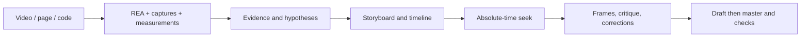

# Codex Motion Design

> **Experiment suspended — visual goal not achieved.** This project has been
> set aside after two local GPT-6 Astra trials, at `high` and then `ultra` effort.
> The user judged the artistic result inadequate, including a short action whose
> mechanics had been verified. The repository retains the tools and evidence
> from this experiment; it does not demonstrate production capability or studio quality.
>
> **[Read the closeout report](docs/EXPERIMENT_REPORT.md)** ·
> [Observed limitations](docs/LIMITATIONS.md) ·
> [Capability scope](docs/CAPABILITY_MAP.md)

The aim was to adapt principles of motion design workflows associated with Claude
to Codex/GPT through **simple, bounded reverse engineering** of observable tools
and behavior. The experiment produced a local pipeline: storyboard, absolute time,
frame critique and MP4 export with sound. It did not meet the films' artistic standard.

The public film [The Dawn Workshop](docs/assets/morning-press/film.mp4), 14 seconds
made with Astra at `high` effort, retains its graphical and mechanical-logic defects
beneath the lever. A second local six-second trial at `ultra` effort verified the
mechanics, but its graphics were judged extremely poor. That second trial remains
private. Other effort levels, including `max`, were not run locally.

The user reports markedly better renders with Claude Opus 5.5 in personal trials
elsewhere. This external feedback informs their decision to set this project
aside; no controlled model comparison was performed here. The observed block
with Astra is an operational conclusion for this experiment, without universal scope.

**No new creation or automatic restart is planned.** Restarting requires an explicit
user request. The **GPT-6 Astra exclusively** authorship rule remains in
[AGENTS.md](AGENTS.md) and the [Astra workflow](docs/ASTRA_WORKFLOW.md). The instructions
below explain and reproduce the retained files. Rendering runs locally with Node,
Playwright and FFmpeg, without a model SDK, API key, plugin or Claude dependency.

## Retained technical demonstrations


[Core film with sound](docs/assets/core/film.mp4) ·
[Storyboard](examples/core-demo/STORYBOARD.md) · [Executed validation](docs/CORE_VALIDATION.md)

Archived media and manifests retain their original capture hashes. Original source
bytes are recoverable at the pinned historical commits; current English documents
and UI are translations, with no new render claimed. See
[translation provenance](docs/assets/TRANSLATION_PROVENANCE.md).

This is an independent project, not an official OpenAI product. The implementation
is original. The [capability map](docs/CAPABILITY_MAP.md) distinguishes executable
functions from the limits of the delivered scope.

The [`motion/1` core](docs/CORE.md) compiles a **JSON descriptor** into scenes,
persistent objects, tracks and independent frames: keyframes, bounded cubic,
springs with position/velocity retargeting, trajectories, logarithmic camera,
masks and transitions. Canvas 2D and SVG DOM render the same computed state.
[The Seed and the Fold](examples/core-demo/STORYBOARD.md), an original ten-second,
three-shot film, serves as a technical demonstration of this API. The
[core checks](docs/CORE_VALIDATION.md) complement Signal's checks.

```sh
npm run core:sheet
npm run core:verify
npm run core:draft
npm run core:render -- --samples=4
```

After `npm run studio`, open the
[core film](http://127.0.0.1:4173/examples/core-demo/index.html) or its
[SVG version](http://127.0.0.1:4173/examples/core-demo/index.html?adapter=svg).
The player accepts a descriptor through `?project=/chemin/film.json`.
The legacy commands below retain Signal as the default example. Signal remains a
[compatibility film with sound](docs/assets/signal.mp4), with its
[storyboard](STORYBOARD.md) and [historical checks](docs/VALIDATION.md).

## Reproduce the examples locally

Prerequisites: **Node 22.12+**, npm, Chromium and FFmpeg with the `libx264` encoder.
Chromium is installed through Playwright; FFmpeg is installed separately and must
be on PATH or specified through `FFMPEG_PATH`.

```sh
git clone https://github.com/coconut971/codex-motion-design.git
cd codex-motion-design
npm ci
npx playwright install chromium
npm run doctor
npm test
npm run verify
npm run studio
```

Open the [local player](http://127.0.0.1:4173). It supports playback and scrubbing;
no remote service is needed. To render:

```sh
npm run sheet
npm run draft
npm run render -- --samples=4
```

Outputs: `out/sheet.png`, `out/draft.mp4` and `out/signal.mp4`, with adjacent WAV
files and manifests. The example lasts **8 s, 1920×1080, 30 fps**, on a 120 BPM grid.
The draft uses 960×540 at the same frame rate. Add `--overwrite` to replace an
existing output: `npm run draft -- --overwrite`.

On Linux, `npx playwright install --with-deps chromium` also installs required
system libraries. In PowerShell, an installed browser or FFmpeg can be selected
for the session:

```powershell
$env:CHROME_PATH = 'C:\Program Files\Google\Chrome\Application\chrome.exe'
$env:FFMPEG_PATH = 'C:\outils\ffmpeg\bin\ffmpeg.exe'
npm run doctor
$env:RENDER_INTEGRATION = '1'
npm test
```

The three export-failure, readiness and complete-audio tests are enabled by
`RENDER_INTEGRATION=1` and require a browser plus FFmpeg. CI enables them, verifies
seeks and renders a small MP4. Ordinary calculation tests need none of these prerequisites.

## Retained instructions and prompts

[AGENTS.md](AGENTS.md) establishes dormant status and reproduction rules.
[.codex/config.toml](.codex/config.toml) retains **GPT-6 Astra** as the project's
default model. This file does not change the model of a running conversation;
any creative restart must verify the active model and follow the
[Astra workflow](docs/ASTRA_WORKFLOW.md).

The [creation prompts](prompts/01-produce.md) are retained to document the method
tried. They also cover [direction](prompts/02-art-direction.md),
[critique](prompts/03-critique.md), [retiming/sound](prompts/04-retime-and-sound.md),
[debugging](prompts/05-debug-render.md) and
[reverse engineering with REA](prompts/07-reverse-engineer.md).

Automatic local file reading, Node execution and REA access depend on session
tools. The [Codex handoff prompt](prompts/06-chatgpt-handoff.md) describes how to
transfer files and execution evidence. These documents remain experimental
references and do not authorize new trials.

## REA: investigate an existing reference

[REA — Reverse Engineer Anything](https://github.com/morluto/rea) is an MIT tool
compatible with Codex. It supplements investigation of a page, app or code;
it remains **optional**, outside film dependencies and rendering CI. The audited
version is 6.5.0 and requires Node `^22.19.0`, `^24.11.0` or `>=26`.

Official installation:

```sh
npx rea-agents setup
```

To target Codex and inspect changes before installation:

```sh
npx rea-agents@6.5.0 setup --client codex --dry-run
npx rea-agents@6.5.0 setup --client codex
```

Review proposed changes, then restart Codex. Setup configures the MCP server and
REA instructions; it adds no Claude dependency to the project. Details,
configuration paths and checks are in [REA_WORKFLOW.md](docs/REA_WORKFLOW.md).
Actual installation status and local checks are recorded in that guide. Installing
on one machine does not configure the machine of someone cloning the repository.

The [Signal case with REA](docs/cases/REA_SIGNAL.md) documents the concrete path
HTML → observations → `seek(t)` reconstruction → frame comparison → rendering,
with its commands, evidence and limits.

The [investigation prompt](prompts/07-reverse-engineer.md) retains the method:
isolate a behavior, connect each finding to evidence, distinguish observations,
measurements and hypotheses, then describe motion in absolute time.

For a **video**, extract timestamped frames and measure cuts, trajectories and
contacts with FFmpeg/Playwright as appropriate to the source. REA helps with the
associated page or code when available; it cannot recover original source code
from pixels alone. For a **page**, record before/after states and motion triggers.
For **code**, trace parameters, timelines and resources. Keep investigation in
`work/`, then transfer useful measurements to the storyboard and project cues.



## Technical contracts

| Topic | Implemented or verified rule |
| --- | --- |
| Pure time | `seek(t)` rewrites the entire image, continuous time, stable hash and seed |
| Springs | Analytical underdamped, critical and overdamped responses; explicit ζ |
| Art direction | Composition and hold instructions; final quality not guaranteed |
| Beat grid | One JSON, zero-based beats, explicit offset and named cues |
| Sound | The same cues drive the 48 kHz stereo WAV and visual contact |
| Critique | Key images, sheet per beat, strips, crop, thumbnail and log |
| Capture | Local Canvas 2D, readiness, fatal errors, subframes constrained by cuts |
| Export | Temporary MP4, both streams decoded and frames counted before delivery |

Read [MOTION_RULES.md](docs/MOTION_RULES.md) for artistic choices and formulas,
and [RENDER_CONTRACT.md](docs/RENDER_CONTRACT.md) for the exact interface. Blur
averages sRGB pixels: this is an approximation documented in the manifest. Video
export captures Canvas 2D. The core's SVG DOM adapter can be viewed and is tested;
arbitrary DOM/WebGL capture is not delivered.

Targeted captures:

```sh
node scripts/render.mjs --stills=.4,1.4,3.8,6.8 --scale=.5 --out=out/keys.png
node scripts/render.mjs --strip=1.8:2.2 --crop=580,200,760,680 --scale=.5 --out=out/contact.png
node scripts/render.mjs --stills=6.8 --scale=.1875 --out=out/mobile.png
```

A sheet does not prove the absence of flashes between its samples. A determinism
test does not judge visual quality. A measured peak replaces neither LUFS
measurement nor listening: [limitations actually encountered](docs/VALIDATION.md)
are delivered with the results.

## Structure

```text
AGENTS.md                  persistent Codex / ChatGPT rules
.codex/config.toml         default Astra model for this Codex project
STORYBOARD.md              example intent and chronology
REVIEW.md                  verified observations and corrections
project.json               format, seed, beat grid, cues, sound
examples/signal.html       example page and player
examples/signal.mjs        original seek(t), drawing and preview driver
lib/motion.mjs             springs, superposition, hash, interpolation
lib/project.mjs            project validation and beats/seconds conversion
core/                      film compilation, tracks, geometry, pure adapters
examples/core-demo/        original 10 s JSON film, Canvas/SVG player and review
scripts/                   server, doctor, capture, audio, verification
tests/                     mathematical contracts, timing, errors and confinement
prompts/                   seven reusable briefs
docs/                      closeout report, limits, capabilities, contracts, REA and evidence
.github/workflows/         reproducible Linux validation
package-lock.json          locked versions
```

`out/`, `work/` and dependencies are ignored. Research clones are not bundled.
Delivered media are generated from the repository examples.

## Provenance and license

Original code and prompts are under [MIT](LICENSE). Playwright is under Apache-2.0;
Chromium and FFmpeg retain their own licenses. REA remains an external MIT tool.
No third-party fonts or music are bundled.

Third-party content remains subject to its respective licenses. No studied
commercial content is reused in this repository.
