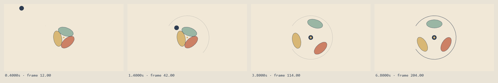

# Validation exécutée — 17 octobre 2026

Le rapport initial ci-dessous et ses assets décrivent le cœur publié au commit
`4951f89` (même arbre au merge `9e0b8f8`). Les fichiers et manifests historiques
ne sont pas réattribués aux ajouts ultérieurs. La section finale datée
« installation REA appliquée et cas HTML » consigne les nouveaux contrôles.

Contrôles réalisés sous Windows, Node `24.18.1`, Playwright `1.64.1`, Chrome
`155.0.8059.84`, FFmpeg `N-92722-gf22fcd4483` (build 2018). Ce sont les versions
réellement testées, pas des minima recommandés. La CI Linux possède son propre
contrôle avec le Chromium Playwright installé et le FFmpeg de la distribution.

## Calcul et contrat

`npm run doctor` réussit. Avec `RENDER_INTEGRATION=1`, `npm test` : **14 réussis,
0 échec, 0 ignoré**. Les cas incluent :

- Conditions initiales, équation différentielle et convergence des springs dans
  les trois régimes ; continuité d'une track au repos et refus d'une vitesse
  initiale réappliquée à chaque changement.
- Beats → secondes → frames → échantillons, retiming partagé image/son,
  validation du descriptor et immutabilité des entrées.
- Shutter borné au plan, grille avec offset, arguments invalides, confinement
  serveur et refus d'un symlink qui sort de sa racine.
- Audio déterministe, durée PCM exacte, attaque à zéro et marge en crête.
- Erreur de capture préservant le MP4 précédent, nettoyage du temporaire,
  promesse de readiness bloquée interrompue par une vraie échéance.
- Rendu réel avec son complet jusqu'au cue final ; rejet d'un MP4 volontairement
  tronqué à cinq secondes.

Une copie propre des fichiers préparés pour Git, dans un chemin contenant un
espace, a passé `npm ci`, ces mêmes 14 tests et `npm run verify`. Cette copie
n'a pas réutilisé le `node_modules` du projet initial.

`npm run verify` compare le SHA-256 de **tous les octets RGBA** à 22 instants :
repères, ±1 frame, ouverture/fin et sous-images continues. Après les références
chronologiques, cinq passes réussissent : ordre inversé, mélangé, répété,
après ouverture d'une autre taille, page fraîche. Les captures à 1,234 et
1,235 s diffèrent ; le temps n'est pas arrondi à la frame entière. Les requêtes
externes sont bloquées et aucun asset externe n'est demandé.

[Résultat des probes](assets/verify-evidence.json). Ces sondes ne prouvent pas
tous les temps réels ni l'identité entre différents systèmes de rasterisation.

## Images inspectées et corrections

Les quatre clés à 0,4 / 1,4 / 3,8 / 6,8 s, la planche par beat, le strip dense
1,8–2,2 s, le crop central et la miniature 360 px ont été ouverts visuellement.
Après revue, le cadrage a été agrandi, la trajectoire d'entrée dégagée et le
contour final renforcé. Les preuves ont été rerendues et ouvertes à nouveau.
Voir [REVIEW.md](../REVIEW.md) pour les observations avant/après.



[Bande du contact](assets/contact.png) · [Miniature 360 px](assets/mobile.png) ·
[Planche décodée du master](assets/decoded-sheet.png)

Des images extraites du MP4 ont également été ouvertes : une grille à deux
images/seconde et les frames exactes 0 et 239. La première et la dernière
reviennent au papier ; le résidu de la fermeture à frame 239 reste très faible.
La grille décodée n'est pas une vérification de chaque frame ni une séquence
étiquetée au frame exact.

## Fichiers effectivement livrés

[signal.mp4](assets/signal.mp4) : **8 s, 1920×1080, H.264 yuv420p, 30 i/s,
240 images**, 710 578 octets. Quatre sous-images par frame, shutter 0,5 frame.
Matrice et primaires BT.709, plage limitée, transfert sRGB conservé et déclaré.
Le blur moyenne des octets sRGB ; il n'intègre pas une luminance linéaire.

Le master a été décodé intégralement avant remplacement de la sortie. L'AAC
stéréo 48 kHz a été redécodé en PCM : **384 000 samples stéréo, 1 536 000 octets,
8,000 s**. Chaque fenêtre sonore possède une énergie non nulle, dont `resolve`
à 6 s (RMS ≈ 0,1062). Les paramètres, empreintes des sources et mesures sont dans
le [manifest livré](assets/render-evidence.json).

La première passe avait un audio tronqué à 5,8667 s par le plafond `-frames:v`.
Ce défaut a été corrigé : le renderer transmet N images puis EOF, borne la durée
globale et contrôle la durée PCM réelle. Le master lié ci-dessus est la passe
corrigée, avec le dernier accent présent.

La mesure `loudnorm` du **fichier livré en entrée du filtre** donne environ
**−17,13 LUFS intégrés**, **−1,00 dBTP**, LRA **2,50 LU**. La sortie filtrée a
été jetée : aucun mastering à −14 LUFS n'est revendiqué. Les valeurs `output_*`
du log ne décrivent pas notre MP4. [Mesure](assets/audio-measurement.json).

Le draft 960×540 a été lancé à vitesse normale dans un élément vidéo Chromium,
en mode muet, et atteint réellement la fin à 8 s sans erreur média.
[Rapport de lecture](assets/playback.json). Cette lecture automatisée ne vaut
ni observation humaine continue ni écoute subjective. L'appréciation visuelle
de l'agent repose sur les captures et strips ouverts ; le son a été contrôlé
techniquement, sans écoute humaine revendiquée.

## REA, provenance et limites

Les six dépôts demandés et REA ont été clonés puis lus à des commits figés.
[Audit et licences](SOURCE_AUDIT.md). Le contenu de la source commerciale reste
exclu. Aucun code, police ou média tiers de ces dépôts n'est embarqué.

REA `6.5.0` : lecture du source, métadonnées npm, aide CLI et setup Codex en
`--dry-run` réellement réussis. Résultat `planned`, zéro action appliquée,
empreinte de la configuration utilisateur inchangée. Aucun serveur MCP ni skill
REA n'a été installé, et aucune enquête REA complète sur une cible n'est prétendue
testée. [Détails et commandes](REA_WORKFLOW.md).

Les articles X originaux demandés n'étaient pas consultables ; les recherches
et URLs candidates sont [consignées](SOCIAL_SOURCES.md), sans attribution technique
inventée. Ce manque documentaire reste explicite.

## Reproduire

```sh
npm ci
npx playwright install chromium
npm run doctor
npm test
npm run verify
npm run sheet
npm run draft
npm run render -- --samples=4
```

Activer `RENDER_INTEGRATION=1` pour les trois tests d'intégration ; renseigner
`CHROME_PATH` / `FFMPEG_PATH` si les exécutables ne sont pas à leur emplacement
attendu. Pour des sorties existantes, ajouter `--overwrite`. Les manifests
locaux enregistrent les entrées du rendu. Une modification du code, du projet
ou des versions demande de nouvelles captures et une nouvelle validation.

## 17 octobre 2026 — installation REA appliquée et cas HTML

Cette section complète le rapport précédent, dont le dry-run était l’état
réel au moment de sa rédaction. Le workflow REA est désormais installé dans
le profil utilisateur : setup `ready`, actions `configured_codex` et
`installed_skill`, puis doctor Codex + skill avec code `0` et `healthy: true`.
Node, l’enregistrement Codex et l’identité du skill sont `ok`. Les providers
natifs hors périmètre ne sont pas configurés ; leur état global ne permet pas
de revendiquer une analyse native opérationnelle.

Le launcher MCP installé a réellement répondu à `initialize` et `tools/list`
depuis un client stdio éphémère : serveur `rea 6.5.0`, protocole `2024-11-05`,
207 outils, une page de catalogue, dialogue terminé en 2,079 s. Le processus
de test a ensuite été arrêté. La conversation d’auteur existante n’a pas
renouvelé son catalogue MCP ; le cas utilise la CLI versionnée.
[Rapport MCP expurgé](assets/rea-case/mcp-smoke.json).

L’enquête sur `/examples/signal.html` a été exécutée sous Node `24.18.1` et
Chrome `155.0.8059.84`, à 960×540, avec la pose de résolution à 6 s.
Les six opérations REA ont terminé : découverte des cibles, inspection de
page, analyse du bundle, screenshot, export des scripts, analyse JavaScript
de l’export. Aucun échec de page ou de ressource n’a été enregistré par le
runner. Trois scripts totalisant 10 894 octets ont été exportés et analysés,
sans erreur de parsing ; le graphe d’application comporte 20 nœuds et
29 relations. La couverture complète du graphe concerne ces fichiers
capturés. La capture elle-même reste limitée par le moment d’attachement et
les filtres documentés. Le candidat endpoint `scale` a été rejeté après
lecture du code : c’est un paramètre d’URL du lecteur.
[Extrait public d’Evidence](assets/rea-case/evidence-summary.json).

Les commandes versionnées, la séparation observation/inférence, la
spécification et les limites sont expliquées dans le
[cas Signal](cases/REA_SIGNAL.md). Les Evidence complètes et les rapports de
configuration restent sous `out/rea-case/` et `work/rea-install/`, ignorés par
Git. Le cas est écrit dans des délégations identifiées GPT-6 Astra par
l’environnement ; cette attribution ne change pas l’auteur des fichiers
historiques. Le rendu reste local sans SDK de modèle ni clé API.

La reconstruction a ensuite été comparée à la référence à **41 instants**,
en **960×540**, avec mêmes dimensions logiques, seed, palette et cues. MAE et
RMSE portent sur les canaux RGB 0–255 ; un pixel est compté comme différent
si un canal diffère de plus de 12. Sur le cadre entier, les maxima sont
**MAE 0,302508**, **RMSE 3,925067** et **0,723765 %** de pixels différents.
Dans la région d’action `[90, 0, 630, 500]`, ils sont **0,485677**, **5,032379**
et **1,191111 %**. MAE/RMSE culminent à 6,033333333 s ; la fraction à 7 s.
Les seuils déclarés dans la spécification sont respectés. Ce sont des mesures
de différence sur des captures sans recalage ni flou, pas une note artistique.
[Rapport complet](assets/rea-case/metrics.json).

Les seuils ont été resserrés après la première mesure : cadre MAE/RMSE
1,5/10, région 2,5/13 et 5 % de pixels différents. Cette calibration après
mesure est explicite. Le contrôle négatif remplaçant la composition à 6 s
par du papier vide est rejeté : cadre 3,863616/19,743721 ; région
6,352139/25,328008 et 7,933016 % de pixels différents.

Les huit passes — inverse, mélangée, répétée, page fraîche, pour la référence
et pour la reconstruction — ont chacune comparé 41 empreintes de tous les
octets RGBA avec égalité. Les sous-images 1,234 et 1,235 s sont distinctes dans
les deux films. Aucun échec de page ou de ressource n’a été enregistré. Ces
sondes établissent la reproductibilité aux temps et dans l’environnement
testés, pas pour tous les temps ou toutes les plateformes.

Les quatre compositions reconstruites à 0,4 / 1,4 / 3,8 / 6,8 s, les
[clés comparées](assets/rea-case/key-comparison.png), la
[planche par beat](assets/rea-case/beat-comparison.png), le
[crop du contact 1,8–2,2 s](assets/rea-case/contact-comparison.png) et la
[miniature à 6 s](assets/rea-case/thumbnail-comparison.png) ont été ouverts.
Les trajectoires, positions principales et étapes de lecture sont proches ;
les différences visibles se situent surtout sur les contours et le grain.
Aucun défaut majeur n’a été observé sur ces échantillons ; aucune correction
de mise en scène n’a été jugée nécessaire à cette étape.

Après stabilisation du code du cas, `npm test` avec `RENDER_INTEGRATION=1`
a passé **18 tests, 0 échec, 0 ignoré**. `npm run verify` a de nouveau passé
les 22 temps et cinq ordres du film de référence.
`npm run rea:render -- --overwrite` a produit le draft 960×540 puis le master 1920×1080, chacun
8 s, 30 i/s, 240 images et quatre sous-images par frame, shutter 0,5 frame.

Le [master reconstruit livré](assets/rea-case/final.mp4) mesure **681 116 octets**
et son SHA-256 est enregistré dans le
[manifest public](assets/rea-case/render-evidence.json). L’export H.264 yuv420p
déclare plage limitée, matrice et primaires BT.709, transfert sRGB conservé.
Le blur moyenne les octets sRGB ; aucune intégration en luminance linéaire
n’est revendiquée. Les 240 images ont été intégralement décodées avec succès
avant remplacement de la sortie, sans erreur de page ni de ressource.

L’audio AAC redécodé en PCM 16 bits stéréo à 48 kHz contient **384 000 frames
audio**, soit **1 536 000 octets et 8,000 s**. Les cinq fenêtres de cues sont
non silencieuses ; celle de `resolve` à 6 s a un RMS d’environ **0,106217**.
Le WAV source possède zéro sample écrêté et une crête de **−1,000152 dBFS**.
Ces mesures ne sont ni une mesure LUFS du nouveau master ni une écoute.

Les 18 empreintes de sources du dernier manifest correspondent aux fichiers
livrés. La [planche extraite du MP4](assets/rea-case/decoded-sheet.png) et les
frames exactes [0](assets/rea-case/first.png) et
[239](assets/rea-case/last.png) ont été ouvertes. L’ouverture est du papier ;
la dernière frame contient encore une silhouette très faible pendant la fin
du fondu. La planche décodée montre l’entrée, le contact, l’ouverture et la
tenue finale ; elle ne représente pas une inspection de chaque frame.

Le dernier draft 960×540 a été lu automatiquement dans Chromium en mode muet
à vitesse 1 et a réellement atteint `ended`, de 0 à 8 s, sans erreur média.
Le [rapport de lecture](assets/rea-case/playback.json) contient l’empreinte du
brouillon testé. Cette vérification ne vaut pas une observation humaine
continue ni une écoute subjective. L’appréciation visuelle repose sur les
images et bandes effectivement ouvertes.
