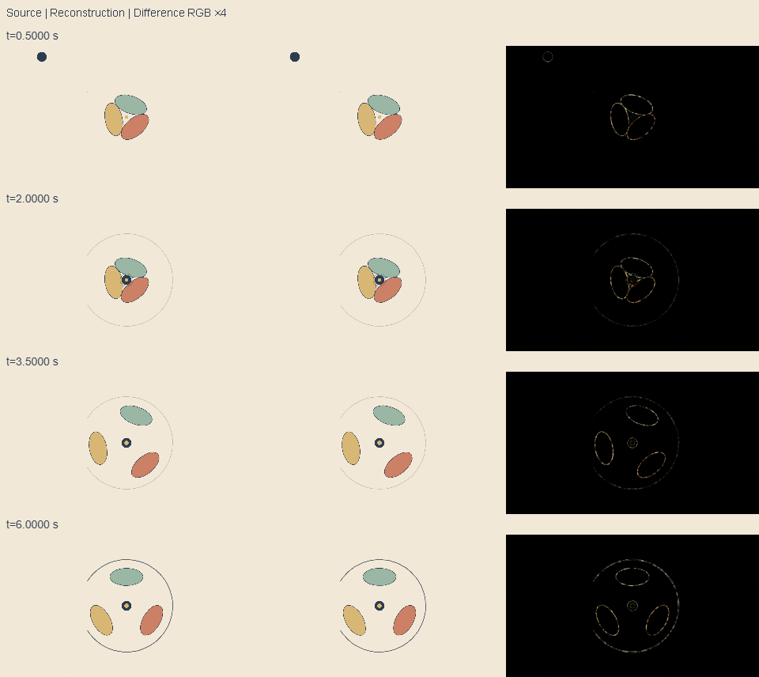

# Signal : d’une page HTML à un film reconstruit

Ce cas part d’une page de démonstration appartenant au dépôt,
[`examples/signal.html`](../../examples/signal.html), et utilise REA `6.5.0`
pour conserver des preuves de son fonctionnement dans Chromium. L’objectif
est concret : comprendre les états visibles, écrire une nouvelle scène
`seek(t)`, comparer ses images à la référence et produire un MP4 avec son.

La cible est choisie parce que son code et ses assets sont redistribuables.
Ce n’est pas une récupération de code tiers fermé. Les sources sont accessibles
pendant l’enquête : la réimplémentation est indépendante du module de référence,
mais ce cas n’est pas une expérience « clean-room ». La séparation se vérifie
dans les imports, les fichiers et les preuves, pas dans une affirmation
d’ignorance du code original.

## Qui fait quoi

Astra mène l’enquête, établit la spécification, écrit la scène et critique les
captures, conformément à [ASTRA_WORKFLOW.md](../ASTRA_WORKFLOW.md). REA inspecte
la page et les scripts ; il ne génère pas le film. Playwright pilote les appels
`seek(t)` et capture les pixels. Le renderer local et FFmpeg produisent l’image
et le son sans SDK de modèle, appel de modèle ou clé API au rendu.

REA a effectivement été installé pour Codex le 17 octobre 2026. Le setup a
renvoyé `ready` et les actions `configured_codex` et `installed_skill` ; le
doctor ciblé Codex + skill a renvoyé `healthy: true`. La session en cours
n’avait pas renouvelé sa découverte MCP : l’enquête emploie la CLI versionnée.
Un client stdio séparé a néanmoins réussi le dialogue avec le launcher
installé et découvert ses 207 outils ; ce contrôle réel ne vaut pas
attachement du MCP à la conversation déjà ouverte.
Cette distinction et les limites des providers natifs sont consignées dans
[REA_WORKFLOW.md](../REA_WORKFLOW.md#installation-appliquée-le-17-octobre-2026).

## Reproduire les étapes

Les prérequis sont ceux du renderer, plus Node compatible avec REA `6.5.0`
(Node `22.19+` dans la branche 22, `24.11+` dans la branche 24, ou `26+`).
Le cas utilise une page servie localement et un navigateur dédié. Les ports
sont choisis à l’exécution ; aucune URL de production n’est visée.

```sh
npm ci
npx playwright install chromium
node scripts/rea-case.mjs --phase=investigate --out=out/rea-case --overwrite
node scripts/rea-case.mjs --phase=compare --out=out/rea-case --overwrite
node scripts/rea-case.mjs --phase=render --out=out/rea-case --overwrite
```

`--phase=all` enchaîne les trois étapes. `CHROME_PATH` et `FFMPEG_PATH`, ou
`--chrome=…` et `--ffmpeg=…`, sélectionnent les exécutables locaux.
`--npm-cli=…` permet de donner le chemin absolu de `npm-cli.js` si le runner
ne peut pas le trouver. `--overwrite` exprime le remplacement des sorties
existantes. L’installation de REA n’est pas relancée par le cas.

Le runner appelle successivement ces commandes via
`npm exec --ignore-scripts --yes --package=rea-agents@6.5.0 -- rea` :

```text
list-browser-targets ENDPOINT --json
inspect-web-page ENDPOINT TARGET_ID --observation-ms 1000 --include-script-sources --json
analyze-web-bundle ENDPOINT TARGET_ID --json
capture-web-screenshot ENDPOINT TARGET_ID --json
export-web-scripts CAPTURE_JSON NOUVEAU_DOSSIER --json
analyze-javascript-application NOUVEAU_DOSSIER/files --json
```

`ENDPOINT` et `TARGET_ID` désignent le navigateur et la cible réellement ouverts.
Les arguments résolus, les versions, les empreintes SHA-256 des sources et les
références des rapports sont enregistrés dans `out/rea-case/evidence/index.json`.
Les Evidence complètes restent dans le même dossier ignoré par Git. Leur
conservation permet de relire l’enquête entre plusieurs appels CLI, sans
confondre un identifiant de session MCP avec un fichier durable.

## Observation, mesure et interprétation

La référence dessine un film sans texte dans un Canvas ; les commandes du
lecteur sont masquées en mode capture. Le projet possède un espace logique
1920 × 1080, une durée de 8 s, une cadence de 30 i/s, une grille à 120 BPM et
une seed de 17. Ces paramètres sont lus dans le descriptor et le module de
référence, pas déduits de la seule capture.

| Élément | Fait vérifiable dans la référence | Interprétation retenue |
| --- | --- | --- |
| Temps | Le module expose `window.seek(seconds)` ; le pilote de lecture est séparé. | Une image peut être reconstruite à partir du temps absolu. Cette propriété doit ensuite être testée sur la nouvelle scène. |
| Composition | Une impulsion, trois ovales et une couronne ouverte ; palette papier, indigo, sauge, terre cuite et or. | Un signal organise des fragments et laisse une forme finale lisible. |
| Mouvement | Courbes continues, springs analytiques, léger décalage entre fragments et traits variant à 12 Hz. | Le délai et l’amortissement donnent une succession lisible, sans exiger de simulation accumulée. |
| Caméra | La référence applique une échelle fixe de 1,2 autour du centre. | Conserver un cadre fixe et une occupation comparable facilite la lecture et la comparaison. |
| Son | Les événements du descriptor portent les fréquences, gains, durées et panoramiques. | Reprendre les événements partagés pour la synthèse locale évite une seconde timeline manuscrite. |

REA observe ici une page déjà chargée. Une fenêtre sans nouvelle requête réseau
ne signifie donc pas qu’aucune ressource n’a été chargée. La capture REA est un
artefact du viewport. Le PNG `source-resolve.png`, obtenu après un appel
Playwright à `seek`, est identifié séparément ; il n’est pas attribué à une
évaluation temporelle passive par REA. L’export de scripts renseigne le
contenu effectivement capturé, sans promettre une application complète ni
des source maps absentes.

Dans cette exécution, l’inspection a retenu 30 nœuds DOM. Trois scripts ont
été observés, analysés puis exportés : `examples/signal.mjs`, `lib/motion.mjs`
et `lib/project.mjs`, soit 10 894 octets. L’analyse statique de cet export a
parcouru 2 626 nœuds AST sans erreur de parsing et produit un graphe
d’application de 20 nœuds et 29 relations. La couverture dite `complete`
concerne ces trois fichiers. La capture d’origine reste `policy_filtered` et
`attach_limited`, notamment avec neuf scripts exclus faute d’origine
attribuable ; elle ne constitue pas une copie exhaustive de l’état navigateur.

Un exemple utile de lecture critique apparaît dans le bundle : REA trouve les
deux imports locaux et l’appel `fetch('../project.json')`, mais propose aussi
`scale` comme endpoint de faible confiance. La lecture de la ligne concernée
montre `params.get('scale')` : c’est le nom d’un paramètre d’URL du lecteur,
pas une requête réseau. Le cas conserve cette inférence rejetée au lieu de la
transformer en fait. Les empreintes et ces constats sont dans
[l’extrait public d’Evidence](../assets/rea-case/evidence-summary.json).

## Spécification avant reconstruction

Le [storyboard du cas](../../examples/rea-signal/STORYBOARD.md) a été écrit
avant le [module reconstruit](../../examples/rea-signal/reconstruction.mjs).
La [spécification figée](../../examples/rea-signal/spec.json) sépare les
observations REA, les valeurs lues dans le code, l’interprétation de la scène
et les choix de dessin. Elle lie la référence à ses empreintes ; le runner
refuse une comparaison si le module, le descriptor source ou les helpers
partagés de mouvement et de projet ont changé.

Les étapes de lecture restent : apparition, approche, contact, ouverture des
fragments, alignement, résolution tenue, disparition. Les événements nommés
du descriptor font autorité pour leurs instants ; le storyboard explique la
mise en scène sans créer une seconde source de secondes.

La caméra est fixe. L’impulsion guide l’œil jusqu’au contact, puis les trois
fragments prennent le relais avec un décalage. La couronne finale doit rester
compréhensible à petite taille et tenir assez longtemps avant la fermeture.
Le grain et le trait vivant appartiennent au vocabulaire visuel ; leur hasard
est calculé depuis une seed, un identifiant stable et un tick explicite.

La reconstruction doit réécrire tout le Canvas à chaque `seek(t)`, garder le
temps continu entre les frames et séparer le pilote de lecture du calcul.
Elle peut partager les helpers du moteur et le descriptor, mais n’importe pas
`examples/signal.mjs`. Cette distinction permet une nouvelle implémentation
du dessin tout en conservant une seule timeline pour image, son et contrôle.

Le nouveau module sépare `poseAt(seconds, project, spec)` et le dessinateur.
Il emploie 48 sommets par ovale, 80 segments par arc et 2 400 grains avec de
nouveaux identifiants de variation. Les valeurs de mouvement conservées sont
explicitement lues dans le code de référence : elles ne sont pas présentées
comme un ajustement mathématique unique déduit des pixels. Le
[descriptor de reconstruction](../../examples/rea-signal/project.json)
porte les cues et les sons de ce film ; le comparateur contrôle sa concordance
avec la référence, hors identifiant du projet.

## Évaluer le résultat

Comparer les images de la référence et de la reconstruction aux mêmes temps,
dimensions et paramètres navigateur. Les planches côte à côte montrent la
composition ; les images de différence localisent les écarts. Les métriques
MAE, RMSE et fraction de pixels différents décrivent ce périmètre rasterisé,
sans constituer une note de qualité artistique. Elles ne démontrent pas une
équivalence pour tous les temps, toutes les plateformes ou toutes les tailles.

Le calcul porte sur les canaux RGB en niveaux 0–255, sans alpha. Un pixel est
compté comme différent lorsqu’au moins un canal diffère de **plus de 12**.
Outre le cadre entier, une région logique `[180, 0, 1260, 1000]` contient
l’action, soit `[90, 0, 630, 500]` à l’échelle de comparaison 0,5. Aucun
recalage spatial ni flou temporel n’est appliqué. Après la première mesure,
les limites de régression ont été resserrées dans la spécification :
MAE/RMSE ≤ 1,5/10 sur le cadre, ≤ 2,5/13 sur la région, et ≤ 5 % de pixels
différents dans cette région. Il s’agit d’une calibration explicite après
mesure, pas de seuils prédéclarés pour une évaluation aveugle. La différence
visuelle est amplifiée ×4 dans les planches ; cette amplification ne modifie
pas les métriques.

Les seeks inversés, répétés et sur une page fraîche comparent la reconstruction
à elle-même. Ils répondent à une autre question que la similarité avec la
référence : un même temps redonne-t-il les mêmes pixels après un historique
différent ? Le rendu vidéo et le décodage audio sont ensuite vérifiés comme
des sorties distinctes. Une piste présente et mesurée ne vaut pas une écoute.

## Résultats de la comparaison exécutée

Les 41 instants testés couvrent les beats, les cues à ±1 frame, le contact de
1,8 à 2,2 s par pas de 1/30 s, les extrémités utiles et deux sous-images à
1,234 et 1,235 s. Les mesures portent sur 960×540 pixels ; la région d’action
contient 315 000 pixels.

| Maximum sur les 41 captures | Cadre entier | Région d’action |
| --- | ---: | ---: |
| MAE RGB, niveaux 0–255 | 0,302508 | 0,485677 |
| RMSE RGB, niveaux 0–255 | 3,925067 | 5,032379 |
| Pixels avec un canal différent de plus de 12 | 0,723765 % | 1,191111 % |

Les maxima MAE/RMSE surviennent à 6,033333333 s, ceux de fraction différente
à 7 s. Tous les seuils de régression sont respectés. Les huit passes de
déterminisme — ordre inverse, mélangé, répété et page fraîche pour chacun des
deux films — redonnent les mêmes empreintes SHA-256 de tous les octets RGBA,
41 probes par passe. Les sous-images à 1,234 et 1,235 s sont distinctes dans
les deux films. Aucun échec de page ou de ressource n’a été enregistré.
[Mesures complètes](../assets/rea-case/metrics.json).

Un contrôle négatif remplace la composition résolue à 6 s par du papier vide.
Il est rejeté : MAE/RMSE du cadre 3,863616/19,743721 ; région d’action
6,352139/25,328008, avec 7,933016 % de pixels différents. Ce contrôle vérifie
que la grande surface de papier commune ne suffit pas à faire passer une
reconstruction qui aurait perdu les objets.



La revue a ouvert les quatre compositions à 0,4 / 1,4 / 3,8 / 6,8 s, puis la
comparaison aux cues 0,5 / 2 / 3,5 / 6 s, la
[planche par beat](../assets/rea-case/beat-comparison.png), le
[crop dense du contact](../assets/rea-case/contact-comparison.png) et la
[miniature finale](../assets/rea-case/thumbnail-comparison.png). L’entrée
depuis le haut gauche, le regroupement au contact, la séparation des fragments
et le renforcement du contour final conservent la lecture de la référence.
Les différences visibles se concentrent sur les contours et le grain,
conformément aux choix du nouveau dessinateur.

Dans cette comparaison avant/après reconstruction, aucun défaut majeur de
position ou de timing n’a été observé sur les images inspectées. Aucune
correction de mise en scène n’a été jugée nécessaire sur ces échantillons.
Le choix de conserver les nouveaux contours laisse un écart pixel non nul
assumé. La revue par images ne
prouve ni la qualité à chaque instant ni une observation continue du film.
La [revue du cas](../../examples/rea-signal/REVIEW.md) distingue ce constat
visuel des corrections réellement apportées au workflow de contrôle.

Les exports et leurs contrôles sont consignés dans
[VALIDATION.md](../VALIDATION.md). Le
[film reconstruit avec son](../assets/rea-case/final.mp4) dure 8 s en
1920×1080 à 30 i/s, soit 240 images, avec quatre sous-images par frame.
Son [manifest](../assets/rea-case/render-evidence.json) conserve les paramètres,
empreintes des sources et résultats du décodage. Le son est contrôlé
techniquement ; aucune écoute subjective n’est revendiquée.
La [planche décodée](../assets/rea-case/decoded-sheet.png) et les frames
exactes 0 et 239 ont été ouvertes ; la dernière conserve un résidu très faible
du fondu. Une [lecture muette automatisée](../assets/rea-case/playback.json)
du draft a atteint la fin à 8 s sans erreur média. Elle ne vaut pas une
observation continue par un spectateur.

Les méthodes de temps absolu, de revue par frames et de vérification sont
décrites dans le [contrat de rendu](../RENDER_CONTRACT.md).
